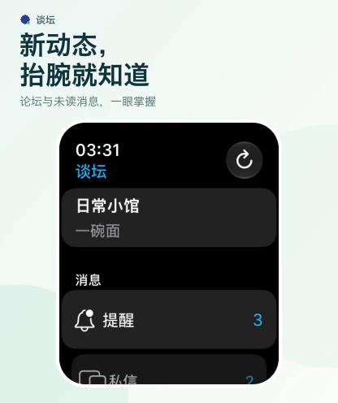
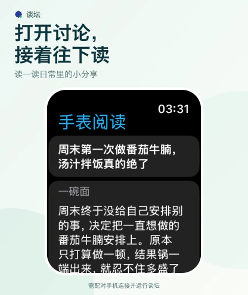

<p align="center">
  
</p>

<h1 align="center">DisFly · 谈坛</h1>

<p align="center">A lightweight Discuz X client built with Flutter.<br>Discover communities, enjoy the discussion, and keep your favorite threads close.</p>

<p align="center">
  <strong>English</strong> · <a href="README_zh.md">简体中文</a><br>
  <a href="https://apps.apple.com/us/app/%E8%B0%88%E5%9D%9B/id1601703772">App Store</a> ·
  <a href="https://play.google.com/store/apps/details?id=com.kidozh.discuz_flutter">Google Play</a> ·
  <a href="https://github.com/kidozh/discuz_flutter/releases">GitHub Releases</a>
</p>

## At a glance

- **Your communities in one place.** Add Discuz X forums, manage accounts, explore boards, and choose the boards that appear in your feed.
- **Comfortable reading.** Browse recent and popular threads, read posts and replies with inline images, select text, and return to favorites or browsing history.
- **Translation and AI.** Translate posts, read on-device summaries, and continue AI conversations saved in encrypted local history on supported devices.
- **An interface that fits.** Choose light or dark appearance, theme colors, and typography. Wide screens offer a list alongside the thread, with layout and navigation adapted for iPad and iPhone Duo.
- **Discussions on your wrist.** The Apple Watch companion shows unread counts, threads, reminders, and private conversations, with text replies through your paired iPhone.
- **Optional Android reminders.** Enable background checks for new public posts on selected forums. Checks follow system scheduling and are off by default.

Forum features depend on the site's Mobile API and your account permissions. AI features require a compatible device, system, and available on-device model.

## Screenshots

### Browse, read, and catch up

| Discover discussions | Read posts and replies | See the key points |
| :---: | :---: | :---: |
|  |  |  |

### More room for the conversation

| iPad | iPhone Duo |
| :---: | :---: |
|  |  |

### Apple Watch

| Check unread counts | Read a thread | Write a reply |
| :---: | :---: | :---: |
|  |  |  |

Screenshots use the fictional “日常小馆” community with original sample posts and accounts. Lifestyle images and the banner illustration were AI-generated; the displayed summary is a human-written example of the completed summary interface. Screenshots are in Simplified Chinese. See [marketing assets and capture notes](marketing/README.md).

## Download

| Channel | Link |
| --- | --- |
| iPhone / iPad | [App Store](https://apps.apple.com/us/app/%E8%B0%88%E5%9D%9B/id1601703772) |
| Android | [Google Play](https://play.google.com/store/apps/details?id=com.kidozh.discuz_flutter) |
| Android APK and release notes | [GitHub Releases](https://github.com/kidozh/discuz_flutter/releases) |

The Apple Watch companion requires watchOS 10 or later. Choose a forum and sign in on iPhone first; live reading and replies require the paired iPhone app to be initialized and reachable. See [Apple Watch setup and sync](docs/apple_watch.md).

## Translation and on-device AI

| Platform | Post translation | Summaries and AI conversations |
| --- | --- | --- |
| Apple | Apple's Translation framework; translation is independent of the AI setting | Local Foundation Models when Apple Intelligence is available |
| Android | Google Translate through ML Kit on-device models | Gemini Nano on devices with compatible AICore support |

Language packs may need downloading before translation can run offline. You can switch back to the original post at any time. Android translation is powered by Google Translate: [Google Cloud Translation](https://cloud.google.com/translate).

Read more: [Apple translation and summaries](docs/apple_post_translation.md) · [Android translation](docs/android_post_translation.md) · [Encrypted AI conversation history](docs/ai_chat_history.md) · [Android background reminders](docs/android_background_new_posts.md).

## Development

Use Flutter **3.47.0+** and Dart **3.13.0+**; CI currently pins Flutter **3.47.5**. Android builds use Java 17 and Android SDK 37. iOS development requires macOS and Xcode; full iPhone Duo display support requires Xcode / iOS SDK **27.1+**. See the [Duo toolchain and adaptation notes](docs/iphone_duo_adaptation.md).

```sh
git clone https://github.com/kidozh/discuz_flutter.git
cd discuz_flutter
flutter pub get --enforce-lockfile
flutter devices
```

Run on a device listed by `flutter devices` (replace `DEVICE_ID`):

```sh
flutter run -d DEVICE_ID
```

Keep the local dependencies in `third_party/` when cloning or packaging the project. For iOS and Apple Watch, use the normal Xcode signing flow; see the [running and signing notes](docs/apple_watch.md#工程与运行).

### TestFlight release notes

For every TestFlight build, update `docs/testflight-release-notes.txt` with the actual changes and testing focus. Its first line must match the uploaded version and build number, for example `2.0.11 (169)`. Follow the release requirements in [AGENTS.md](AGENTS.md).

```sh
python3 scripts/prepare_testflight_notes.py
```

The App Store workflow validates the notes before building and passes the generated `release-notes` to the upload step. The mandatory `scripts/verify_testflight_release.mjs` step waits for Apple to process the exact version and build, then populates Chinese and fallback-locale notes, reads them back, and preserves a verification receipt. This avoids the upload action matching a build from another version train. The `metadata_only` workflow input retries notes for an existing upload. A manual notes override replaces the repository text. Local Xcode or Transporter uploads must also apply the same notes to the matching build's “What to Test” in App Store Connect and verify that they were saved.

## Terms and privacy

DisFly follows Discuz Hub's [Terms of Service](https://discuzhub.kidozh.com/zh/term_of_use/) and [Privacy Policy](https://discuzhub.kidozh.com/zh/privacy_policy/).
