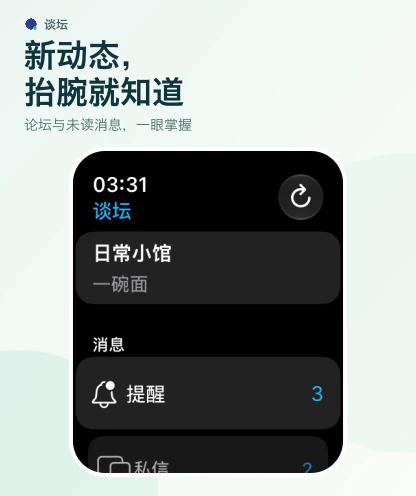
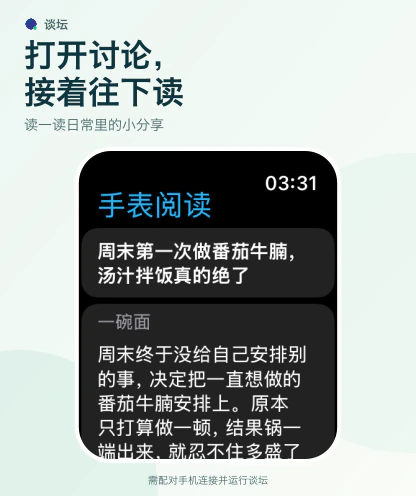

<p align="center">
  
</p>

<h1 align="center">谈坛 · DisFly</h1>

<p align="center">由 Flutter 驱动的轻量级 Discuz X 客户端。<br>发现同好与好帖，让每一次浏览都能接上喜欢的讨论。</p>

<p align="center">
  <a href="README.md">English</a> · <strong>简体中文</strong><br>
  <a href="https://apps.apple.com/us/app/%E8%B0%88%E5%9D%9B/id1601703772">App Store</a> ·
  <a href="https://play.google.com/store/apps/details?id=com.kidozh.discuz_flutter">Google Play</a> ·
  <a href="https://github.com/kidozh/discuz_flutter/releases">GitHub Releases</a>
</p>

## 功能亮点

- **把喜欢的社区放在一起。** 添加 Discuz X 论坛、管理账号、浏览版块，并选择关注的版块来安排首页内容。
- **专注阅读，方便回看。** 浏览最新发布与热门讨论，阅读图文帖子和回复，选择并复制正文，通过收藏和浏览历史找回好帖。
- **翻译与 AI 辅助。** 翻译帖子正文，在兼容设备上使用本机模型总结内容，并继续保存在本机加密历史中的 AI 对话。
- **按设备，也按习惯。** 自选明暗外观、主题配色与排版；宽屏下并排显示列表与正文，适配 iPad 和 iPhone Duo 的布局与导航。
- **抬腕接上讨论。** Apple Watch 配套应用支持查看未读数、帖子、提醒与私信，并通过配对 iPhone 发送文字回复。
- **按需开启新帖提醒。** Android 可为选定论坛后台检查公开新帖，遵循系统调度，默认关闭。

论坛功能受站点 Mobile API 和账号权限影响；AI 功能需要兼容的设备、系统及可用的本机模型。

## 界面预览

### 从发现好帖，到读懂讨论

| 热门讨论，随手掌握 | 打开帖子，专注阅读 | 长帖太长，先看重点 |
| :---: | :---: | :---: |
|  |  |  |

### 大屏展开，列表与正文一起看

| iPad | iPhone Duo |
| :---: | :---: |
|  |  |

### Apple Watch，抬腕继续聊

| 看看未读动态 | 接着阅读帖子 | 顺手回一句 |
| :---: | :---: | :---: |
|  |  |  |

截图使用虚构社区「日常小馆」，帖子、账号等均为原创样例。生活配图和横幅插画由 AI 生成；图中的摘要为人工编写的示例，用于展示总结界面的完成状态。完整素材及制作方式见[营销素材说明](marketing/README.md)。

## 下载安装

| 渠道 | 链接 |
| --- | --- |
| iPhone / iPad | [App Store](https://apps.apple.com/us/app/%E8%B0%88%E5%9D%9B/id1601703772) |
| Android | [Google Play](https://play.google.com/store/apps/details?id=com.kidozh.discuz_flutter) |
| Android APK 与版本说明 | [GitHub Releases](https://github.com/kidozh/discuz_flutter/releases) |

Apple Watch 配套应用支持 watchOS 10 起。首次选择论坛和登录需在 iPhone 完成；实时阅读与回复需要配对的 iPhone 应用已初始化且保持可连接。详见 [Apple Watch 运行与同步说明](docs/apple_watch.md)。

## 翻译与本机 AI

| 平台 | 正文翻译 | 总结与 AI 对话 |
| --- | --- | --- |
| Apple | 使用系统 Translation 框架，独立于 AI 设置开关 | Apple Intelligence 可用时使用本机 Foundation Models |
| Android | 由 Google 翻译提供，使用 ML Kit 设备端模型 | 在支持 AICore 的兼容设备上使用 Gemini Nano |

首次翻译可能需要下载语言包，下载后可离线使用，随时可以切回原文。Android 正文翻译由 Google 翻译提供：[Google Cloud Translation 服务信息](https://cloud.google.com/translate)。

详细说明：[Apple 翻译与总结](docs/apple_post_translation.md) · [Android 翻译](docs/android_post_translation.md) · [AI 对话加密历史](docs/ai_chat_history.md) · [Android 新帖后台提醒](docs/android_background_new_posts.md)。

## 本地开发

使用 Flutter **3.47.0+**、Dart **3.13.0+**，CI 当前固定为 Flutter **3.47.5**。Android 构建使用 Java 17 和 Android SDK 37。iOS 开发需要 macOS 与 Xcode；完整 iPhone Duo 屏幕支持需要 Xcode / iOS SDK **27.1+**，详见 [Duo 工具链与适配说明](docs/iphone_duo_adaptation.md)。

```sh
git clone https://github.com/kidozh/discuz_flutter.git
cd discuz_flutter
flutter pub get --enforce-lockfile
flutter devices
```

从 `flutter devices` 的输出中选择目标设备，将下方的 `DEVICE_ID` 替换为对应 ID：

```sh
flutter run -d DEVICE_ID
```

克隆或打包源码时请保留 `third_party/` 中的本地依赖。iOS 与 Apple Watch 使用 Xcode 的正常签名流程，见[工程、运行与签名说明](docs/apple_watch.md#工程与运行)。

## 服务条款与隐私

谈坛遵循 Discuz Hub 的[服务条款](https://discuzhub.kidozh.com/zh/term_of_use/)和[隐私政策](https://discuzhub.kidozh.com/zh/privacy_policy/)。
